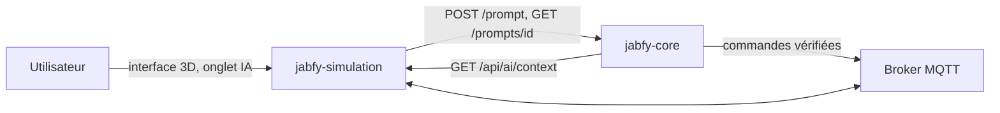

# jabfy-simulation

jabfy-simulation est le laboratoire de simulation de Jabfy : une maison virtuelle personnalisable, avec une interface 3D en français, des appareils simulés qui parlent un vrai MQTT au format Zigbee2MQTT, et son propre bus jabfy-bus avec jabfy-guard embarqués. Pour les adapters de jabfy-bus, ces appareils se comportent comme du matériel réel.

## Rôle dans l'architecture



| Communique avec | Comment | Sens |
|---|---|---|
| jabfy-core | expose l'inventaire de la maison (`/api/ai/context`) ; l'onglet IA envoie les prompts à Core et suit l'exécution | les deux |
| Broker MQTT (Mosquitto) | appareils virtuels au format Zigbee2MQTT | les deux |
| jabfy-bus, jabfy-guard | bibliothèques embarquées : vérification et audit des commandes appliquées depuis l'interface | interne |

Le lancement de la pile complète appartient à jabfy-deploy.

## Pages

- [Installation et lancement](installation.md)
- [Architecture](architecture.md) et [prototype de maison](house-architecture.md)
- [Interfaces](interfaces.md)
- [Tests](tests.md)
- [Sécurité](security.md)
- [État actuel et feuille de route](roadmap.md)
- [Jabfy V0.0.1](v0.0.1.md)
- [Documentation du code, fichier par fichier](code/README.md), pour reprendre le code sans l'auteur d'origine

## Lancement pour le développement

Avec les dépôts voisins `jabfy-bus` et `jabfy-guard`, hors du conteneur `jabfy-sim` :

```bash
python3 -m venv .venv
source .venv/bin/activate
pip install -e "../jabfy-guard" -e "../jabfy-bus[all]" -e ".[ui]"
docker compose -f ../jabfy-deploy/compose.local.yml up mosquitto -d
jabfy-sim ui
```

L'interface est sur `http://127.0.0.1:8080`.
