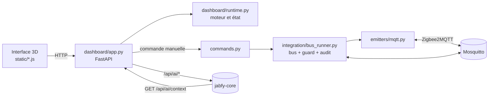

# Architecture

jabfy-simulation émule une maison avec de vrais protocoles pour que les adapters de jabfy-bus la traitent comme du matériel physique.

## Principes

- **Les appareils sont des machines à états.** Elles vivent dans `sim/devices/` et n'ont aucune dépendance réseau ; ne pas en ajouter.
- **La maison est un document.** Le fichier JSON `Home` décrit pièces, appareils et automatismes, sans adresse réseau ni secret. Il alimente l'éditeur, la scène 3D et l'inventaire donné à l'IA.
- **Tout passe par le bus.** Une commande, manuelle ou proposée par l'IA, est vérifiée par jabfy-guard, exécutée par le bus, publiée sur MQTT et écrite dans l'audit.
- **Deux simulateurs existent volontairement.** `jabfy-bus/jabfy_bus/simulation/` injecte dans le cœur du bus ; jabfy-simulation parle MQTT, Modbus et HTTP pour exercer les vrais adapters.
- **Core propose, le simulateur décide.** Core ne commande rien directement : les propositions repassent par la validation locale.

## Protocoles émulés

| Protocole | Appareils | Module |
|---|---|---|
| MQTT, format Zigbee2MQTT | éclairage, sécurité, capteurs, thermostat | `sim/emitters/mqtt.py` |
| Modbus TCP (port 5020) | appareils de climat | `sim/emitters/modbus_server.py` |
| HTTP REST (ports 8001 et 5000) | télévision connectée, NAS | `sim/emitters/http_server.py` |

## Pour aller plus loin

- [Architecture du prototype de maison](house-architecture.md) : document Home v1, contrat HTTP, cohérence d'édition.
- [Documentation du code](code/README.md) : référence fichier par fichier, destinée à reprendre le code sans l'auteur d'origine.
