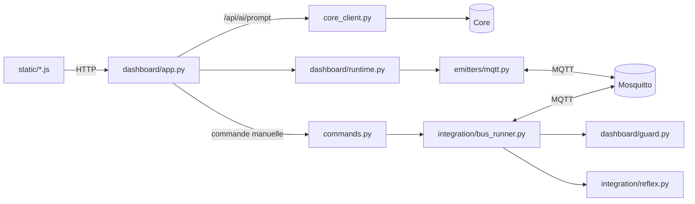

# jabfy-simulation — carte des fichiers

> La maison virtuelle : appareils simulés, UI 3D, son propre bus avec guard et réflexes, passerelle vers Core.

Tests : [tests](tests.md) · build : [build et CI](build.md)

## Schéma

## À lire d'abord

1. [sim/dashboard/app.py](dashboard-app.md) — Serveur FastAPI du simulateur : UI 3D, API maison, commandes manuelles, et passerelle vers Core pour l'onglet IA.
2. [sim/dashboard/runtime.py](dashboard-runtime.md) — État vivant du simulateur (`Dashboard`) : boucle de tick, événements, révision du contexte, file de commandes.
3. [sim/emitters/mqtt.py](emitters-mqtt.md) — Émetteur MQTT : publie l'état des appareils et applique les commandes reçues sur `/set`.
4. [sim/integration/bus_runner.py](integration-bus-runner.md) — Le pipeline jabfy-bus **propre au simulateur** : bus, audit fichier, registre, guard, exécution, réflexes, transports.
5. [sim/dashboard/guard.py](dashboard-guard.md) — `HomeGuard` : autorisation jabfy-guard pour le bus du simulateur.
6. [sim/integration/reflex.py](integration-reflex.md) — `ReflexEngine` : automatisations locales (ex. présence → lampe) proposées sur le bus du simulateur.
7. [sim/dashboard/static/ai.js](static-ai-js.md) — Onglet IA : envoie la demande à `/api/ai/prompt` puis interroge le run toutes les 500 ms.

## Tous les fichiers

### `docker`

| fichier | rôle | statut |
|---|---|---|
| [docker/healthcheck.py](docker-healthcheck.md) | Sonde Docker : simulateur en marche, guard actif, 2 clients MQTT connectés. | actif |
| [docker/start.py](docker-start.md) | Démarrage du conteneur : attend MQTT (60 s) puis lance `jabfy-sim ui` sur 0.0.0.0:8080. | actif |

### `sim`

| fichier | rôle | statut |
|---|---|---|
| [sim/cli.py](cli.md) | Commande `jabfy-sim` : `demo`, `run`, `ui`. | actif |
| [sim/runner.py](runner.md) | `SimRunner` : lance émetteurs MQTT/HTTP/Modbus et le BusRunner en mode `run`. | actif |

### `sim/config`

| fichier | rôle | statut |
|---|---|---|
| [sim/config/loader.py](config-loader.md) | Lit une config YAML/JSON et instancie les appareils. | actif |
| [sim/config/schema.py](config-schema.md) | Modèles pydantic de la config YAML (broker, appareils, règles réflexes). | actif |

### `sim/dashboard`

| fichier | rôle | statut |
|---|---|---|
| [sim/dashboard/app.py](dashboard-app.md) | Serveur FastAPI du simulateur : UI 3D, API maison, commandes manuelles, et passerelle vers Core pour l'onglet IA. | actif |
| [sim/dashboard/commands.py](dashboard-commands.md) | Exécute une commande manuelle via le bus du simulateur et attend son résultat. | actif |
| [sim/dashboard/core_client.py](dashboard-core-client.md) | Client HTTP du simulateur vers Core. | actif |
| [sim/dashboard/defaults.py](dashboard-defaults.md) | Maison par défaut du dashboard (7 appareils, règle mouvement → lumière). | actif |
| [sim/dashboard/guard.py](dashboard-guard.md) | `HomeGuard` : autorisation jabfy-guard pour le bus du simulateur. | actif |
| [sim/dashboard/runtime.py](dashboard-runtime.md) | État vivant du simulateur (`Dashboard`) : boucle de tick, événements, révision du contexte, file de commandes. | actif |

### `sim/dashboard/static`

| fichier | rôle | statut |
|---|---|---|
| [sim/dashboard/static/ai.js](static-ai-js.md) | Onglet IA : envoie la demande à `/api/ai/prompt` puis interroge le run toutes les 500 ms. | actif |
| [sim/dashboard/static/api.js](static-api-js.md) | Petit client `fetch` vers l'API du simulateur. | actif |
| [sim/dashboard/static/app.js](static-app-js.md) | Chef d'orchestre de l'UI : onglets, sauvegarde maison, santé, événements, polling. | actif |
| [sim/dashboard/static/controls.js](static-controls-js.md) | Panneau de commandes manuelles d'un appareil. | actif |
| [sim/dashboard/static/editor.js](static-editor-js.md) | Éditeur de maison (pièces, appareils, automatisations). | actif |
| [sim/dashboard/static/scene.js](static-scene-js.md) | Rendu 3D de la maison avec three.js. | actif |
| [sim/dashboard/static/ui.js](static-ui-js.md) | Aides DOM partagées (création d'éléments, champs, messages). | actif |

### `sim/devices`

| fichier | rôle | statut |
|---|---|---|
| [sim/devices/base.py](devices-base.md) | `Device` : classe de base des machines à états d'appareils simulés. | actif |
| [sim/devices/climate.py](devices-climate.md) | Climat simulé : capteur température/humidité, thermostat. | actif |
| [sim/devices/entertainment.py](devices-entertainment.md) | TV connectée simulée (machine à états). | actif |
| [sim/devices/lighting.py](devices-lighting.md) | Lampes simulées : on/off, variateur, RGB. | actif |
| [sim/devices/security.py](devices-security.md) | Sécurité simulée : capteur de mouvement, serrure, détecteur de fumée, sirène. | actif |

### `sim/emitters`

| fichier | rôle | statut |
|---|---|---|
| [sim/emitters/http_server.py](emitters-http-server.md) | Faux serveurs REST (SmartTV port 8001, NAS port 5000) pour tester l'adapter HTTP. | actif |
| [sim/emitters/modbus_server.py](emitters-modbus-server.md) | Serveur Modbus TCP (port 5020) exposant les registres des appareils climat. | actif |
| [sim/emitters/mqtt.py](emitters-mqtt.md) | Émetteur MQTT : publie l'état des appareils et applique les commandes reçues sur `/set`. | actif |

### `sim/home`

| fichier | rôle | statut |
|---|---|---|
| [sim/home/catalog.py](home-catalog.md) | Catalogue des types d'appareils, de leurs actions et domaines bus. | actif |
| [sim/home/conversion.py](home-conversion.md) | Convertit la maison éditable en config de simulation (topics, règles réflexes) et inversement. | actif |
| [sim/home/models.py](home-models.md) | Modèles de la maison éditable : pièces, appareils, automatisations. | actif |
| [sim/home/store.py](home-store.md) | `HouseStore` : persiste la maison en JSON (écriture atomique). | actif |

### `sim/integration`

| fichier | rôle | statut |
|---|---|---|
| [sim/integration/bus_runner.py](integration-bus-runner.md) | Le pipeline jabfy-bus **propre au simulateur** : bus, audit fichier, registre, guard, exécution, réflexes, transports. | actif |
| [sim/integration/modbus_client.py](integration-modbus-client.md) | Lecteur/écrivain Modbus TCP (pymodbus) branché sur l'adapter Modbus du bus. | actif |
| [sim/integration/reflex.py](integration-reflex.md) | `ReflexEngine` : automatisations locales (ex. présence → lampe) proposées sur le bus du simulateur. | actif |

## Hors pages

`sim/__init__.py`, `sim/*/__init__.py` : ré-exports, pas de page. `static/index.html` (page + importmap three.js), `static/app.css` et `static/vendor/` (three.js, OrbitControls, licence) ne sont pas du code JABFY : pas de page.
